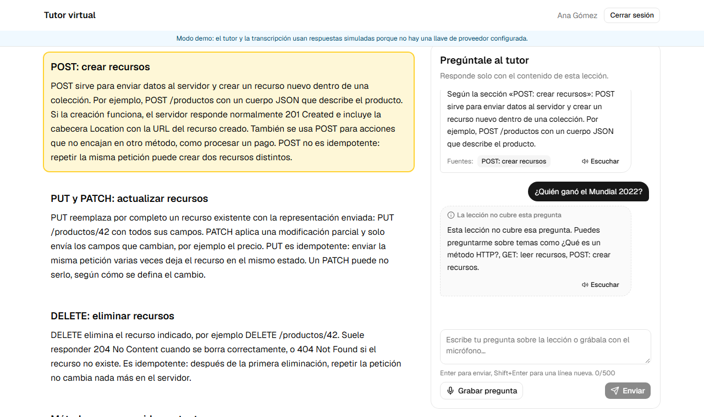
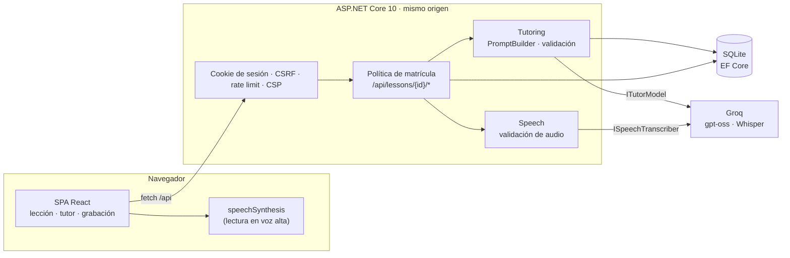

# Tutor virtual con voz para un LMS

[](https://github.com/Yahi-Dev/lms-voice-tutor/actions/workflows/ci.yml)

Prueba de concepto: un alumno abre una lección, pregunta por texto o por voz y recibe una respuesta basada **solo** en el contenido de esa lección, que también puede escuchar. Si la lección no cubre la pregunta, el tutor lo dice. La conversación se guarda por alumno y lección, y una cuenta sin acceso no puede ver la lección ni los mensajes de otros.



## Qué cubre

| # | Requisito del enunciado | Cómo se resuelve |
|---|---|---|
| 1 | Un curso y dos lecciones | Curso *APIs REST desde cero* con *Métodos HTTP* y *Códigos de estado HTTP*, cargado al iniciar. |
| 2 | Un alumno con acceso y otro sin él | **Ana** está matriculada; **Bruno** no. El acceso se comprueba en el servidor en cada petición. |
| 3 | Tutor contextual que avisa si no tiene información | El modelo recibe la lección completa y responde con un esquema JSON estricto: `answered` (con las secciones citadas) o `insufficient_information`. |
| 4 | Preguntas por texto o voz; respuesta audible | La voz se graba en el navegador, se transcribe en el servidor (Whisper) y queda en el cuadro de texto para revisarla antes de enviarla. La respuesta se lee con la síntesis de voz del navegador. |
| 5 | Historial recuperable | Cada intercambio se guarda por alumno y lección; al volver, la conversación aparece de nuevo. |
| 6 | Estado visible y recuperación ante fallos | Estados *Grabando / Transcribiendo / El tutor está pensando*. Mensajes claros y reintento para micrófono bloqueado, sin conexión, servicio caído o saturado; la pregunta nunca se pierde. |

## Inicio rápido

### Opción A: Docker (recomendada)

Requisitos: Docker Desktop.

```bash
cp .env.example .env        # opcional: pega tu llave de Groq en Tutoring__ApiKey
docker compose up --build
```

Abre **<http://localhost:8080>** (el micrófono solo funciona en `localhost` o con HTTPS, no con la IP de la red local).

### Opción B: ejecución local

Requisitos: .NET SDK 10.0.4xx y Node.js 24.

```bash
# Backend: http://localhost:5080 (crea la base SQLite y los datos de prueba al arrancar)
dotnet run --project src/LmsTutor.Server

# Frontend, en otra terminal: http://localhost:5173 (redirige /api al backend)
cd web
npm ci
npm run dev
```

Para usar Groq en local, guarda la llave con *user secrets*. Así nunca termina en el repositorio:

```bash
dotnet user-secrets set "Tutoring:ApiKey" "gsk_..." --project src/LmsTutor.Server
```

## Modo demo y proveedor real

| | Sin llave (modo demo) | Con llave de Groq (gratuita, sin tarjeta) |
|---|---|---|
| Tutor | Modelo de demostración que responde citando la sección con más coincidencias, o informa que la lección no cubre la pregunta | `openai/gpt-oss-120b` con salida estructurada; `openai/gpt-oss-20b` como respaldo si el primero está limitado |
| Transcripción | Devuelve una frase fija (*«¿Para qué sirve POST?»*) tras una grabación real | `whisper-large-v3-turbo` en español |
| Interfaz | Muestra un aviso de *Modo demo* | Sin aviso |

La llave se crea en <https://console.groq.com/keys>. Basta con una para el tutor y la transcripción. En la configuración se llama `Tutoring__ApiKey` (variable de entorno) o `Tutoring:ApiKey` (user secrets).

## Cuentas de prueba

| Alumno | Correo | Contraseña | Acceso |
|---|---|---|---|
| Ana Gómez | `ana@demo.local` | `Ana-Demo-2026!` | Matriculada en el curso |
| Bruno Pérez | `bruno@demo.local` | `Bruno-Demo-2026!` | Sin acceso |

Son datos de evaluación locales, no secretos. La pantalla de inicio de sesión tiene botones para rellenarlas.

## Cómo verificar

| # | Qué probar | Pasos | Resultado esperado | Prueba automática |
|---|---|---|---|---|
| 1 | Contenido | Entra como Ana | El curso con sus dos lecciones | `CatalogAccessTests` |
| 2 | Alumno sin acceso | Entra como Bruno; luego pega la URL de una lección de Ana | *Aún no tienes cursos asignados* y *No tienes acceso a esta lección* | `CatalogAccessTests`, e2e |
| 3 | Tutor contextual | En *Métodos HTTP* pregunta «¿Para qué sirve POST?» y luego «¿Cómo despliego en Kubernetes?» | Respuesta con la fuente *POST: crear recursos*; después, *La lección no cubre esta pregunta* | `TutorTests`, e2e |
| 4 | Voz | Pulsa *Grabar pregunta*, habla, *Detener grabación*; revisa el texto y *Enviar*; pulsa *Escuchar* | La transcripción aparece editable; la respuesta se lee en voz alta | `TutorPanel.test.tsx`, e2e |
| 5 | Historial | Recarga la página o cierra sesión y vuelve a entrar | La conversación sigue ahí | `TutorTests`, e2e |
| 6 | Recuperación | Bloquea el micrófono del sitio; activa *Offline* en DevTools; o ejecuta con `Tutoring__FakeFailure=Unavailable` | Mensaje claro, la pregunta se conserva y aparece *Reintentar* | `TutorPanel.test.tsx`, `TutorTests`, e2e |

Controles de seguridad:

| Control | Cómo comprobarlo | Esperado |
|---|---|---|
| IDOR / acceso | Con la sesión de Bruno: `GET /api/lessons/{id}/messages` de una lección de Ana | `403`; ningún endpoint acepta un id de usuario |
| XSS | Pregunta `` | Se muestra como texto, no se ejecuta |
| Inyección SQL | Inicia sesión con `' OR 1=1--` | `401`: EF Core solo usa consultas parametrizadas |
| CSRF | `POST` a la API sin la cabecera `X-CSRF` | `403` |
| Abuso | Más de 10 preguntas en un minuto | `429` con `Retry-After` |
| Secretos | `git log -p \| grep gsk_` | Sin resultados; el CI ejecuta gitleaks sobre todo el historial |

## Pruebas y CI

```bash
dotnet test --solution LmsTutor.slnx        # 111 pruebas: unitarias e integración (API real + SQLite)
cd web
npm test                                     # 36 pruebas de componentes y lógica (Vitest)
npm run build && npm run test:e2e            # 5 pruebas end-to-end en Chromium con micrófono simulado
```

GitHub Actions ejecuta en cada PR: formato, compilación con warnings como errores, pruebas, auditoría de dependencias, lint y tipos del frontend, pruebas end-to-end, construcción y prueba de humo de la imagen Docker, y escaneo de secretos.

## Arquitectura



```
src/LmsTutor.Server/
  Modules/            Identity · Catalog (cursos, lecciones, matrícula) · Tutoring · Speech
    */Providers/      adaptadores Groq (OpenAI-compatible) y de demostración
  Shared/             persistencia, errores, CSRF, cabeceras, rate limiting
web/src/
  features/           auth · courses · tutor (máquina de estados, grabación, voz)
  shared/             cliente de API, utilidades de medios, componentes UI
tests/                pruebas unitarias e integración (.NET)
web/e2e/              pruebas end-to-end (Playwright)
```

Las decisiones, alternativas y límites están en **[docs/DECISIONS.md](docs/DECISIONS.md)**.

## Solución de problemas

- **El micrófono no funciona:** usa `http://localhost`, no una IP de red; revisa el permiso en el icono junto a la dirección del sitio.
- **La voz suena robótica:** abre la aplicación en **Microsoft Edge**, que trae voces neuronales en español (por ejemplo *Salome* o *Gonzalo* de Colombia, *Dalia* o *Jorge* de México). La aplicación elige la más natural disponible y puedes cambiarla en *Voz de lectura*. Chrome ofrece las voces *Google español*.
- **"Escuchar" está desactivado:** el navegador no tiene ninguna voz en español. En Linux puede faltar.
- **`429` del tutor con Groq:** el plan gratuito permite unas pocas preguntas por minuto para toda la cuenta. Espera los segundos indicados o usa el modo demo.
- **Puerto ocupado:** cambia `APP_PORT` en `.env`.
- **Empezar de cero:** `docker compose down -v` borra la base de datos y las sesiones.
